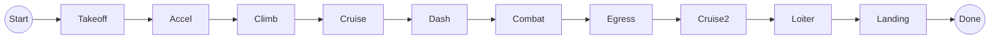
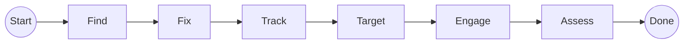
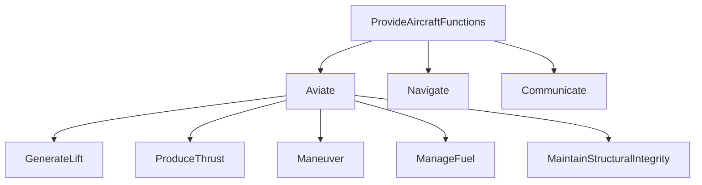

# F Layer — Functions

> `functions/F16A_Functional.slx` (capabilities) · `functions/F16A_MissionActivity.slx` (the mission)
> · `functions/F16A_Functional.sldd` (the mission's typed flows)

The F layer says **what the aircraft must do**, as verb phrases, independent of how it is done.

## Two kinds of function, two metaclasses

A first instinct is to call the ten mission phases (Takeoff, Climb, …) "the functions". But phases
are a **sequence in time**, while capabilities are things the aircraft **can do at any moment**,
reused across many phases. The example keeps them in different metaclasses, so the model itself
makes the distinction (D-059):

| | Artifact | Metaclass | Because |
|---|---|---|---|
| The mission | `F16A_MissionActivity.slx` | activity diagram: **actions** on an object flow | a phase consumes an aircraft state and produces a lighter one |
| The capabilities | `F16A_Functional.slx` | architecture: **components**, no ports | a capability has no input or output of its own |

## The mission: an activity diagram



Ten actions pass a typed `FlightState` object along the flow. Phase names match the Brandt
spreadsheet tabs.

**Each action carries its own behaviour.** Every phase's `BehaviorDefinition` is
`F16AMissionSegment('<phase>')`, so the model records **how** each phase's fuel is computed, not just
a copy of the answer. `F16AMissionReference` runs `sizing/VnV/BrandtF16A/BrandtMission.m` once and
caches it; nothing in `mbse/` restates a segment equation. Each action's `Duration` comes from the
same analysis.

```matlab
F16AMissionAnalysis   % prints the walk: 5,959.80 lb over 94.00 min, within 1% of the spreadsheet
```

The reference has fourteen segments and the model has ten phases: three zero-length `Patrol`
waypoints and a degenerate `Climb2` are left out. The analysis checks that all four still cost zero
fuel and time and stops if that changes, since otherwise the model would fly a cheaper mission than
it claims.

### Combat → the F2T2EA kill chain

Combat's behaviour is a **child activity**, the targeting cycle on a typed `EngagementData` flow:



Find detects targets, Fix locates and identifies them, Track holds them, Target assigns weapons,
Engage releases the expendable payload, and Assess judges the damage. Combat is the one phase without
a MATLAB binding, because an action has one behaviour and Combat's is the kill chain. Its fuel still
comes from the same analysis.

## The capabilities: a decomposition



Nine components organized by the aviator's mantra *Aviate · Navigate · Communicate*, with no ports.
The flows belong to the mission. Sensing and engagement live inside Combat's kill chain rather than
being repeated as capabilities.

## Requirement → function links

Every function is joined to the requirement it satisfies by an **Implement** link. That lets you ask
from either end: is every requirement implemented, and does every function exist for a reason?
There are **39 links**: 21 from capabilities and 18 from mission actions.

| Requirement | Implemented by |
|---|---|
| 001–010 (mission segments) | the ten phase actions, one each |
| 011–016 (point performance) | `GenerateLift` **and** `ProduceThrust` |
| 017 / 018 (field lengths) | `GenerateLift`, `ProduceThrust`, and the `Takeoff` / `Landing` action |
| 019 (9 g) | `MaintainStructuralIntegrity` |
| 021 (payload release) | `Engage` |
| D01–D04 | `Maneuver`, `ManageFuel`, `Navigate`, `Communicate` |
| D05–D09 | `Find`, `Fix`, `Track`, `Target`, `Assess` |

**D01–D09 are the RFLP loop in miniature.** Decomposing the functions turned up behaviour the
sizing-derived requirements never mention. Rather than leave those functions orphaned, each need was
captured as a derived requirement and linked back. Functional analysis feeds *back* into R.

**Six requirements are deliberately not linked here.** 020, 022, 023, 024, 025 and 026 constrain the
*solution* (payload, materials, balance, stability, cost), not the behaviour, so they trace to L or P.

## Interfaces

`F16A_Functional.sldd` holds the two typed flows; the activity is their only user.

| Interface | Elements (all `double`) | Flows through |
|---|---|---|
| `FlightState` | `Time_s`, `Altitude_ft`, `Mach`, `WeightFraction` | the ten phases |
| `EngagementData` | `TargetDetected`, `TargetIdentified`, `WeaponReleased` | the kill chain |

Next: [Logical](04_logical.md). Each capability and kill-chain step is allocated to the role that
realizes it.
