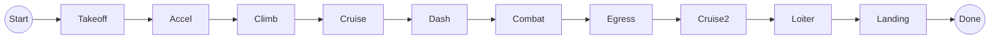
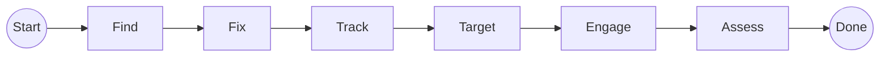
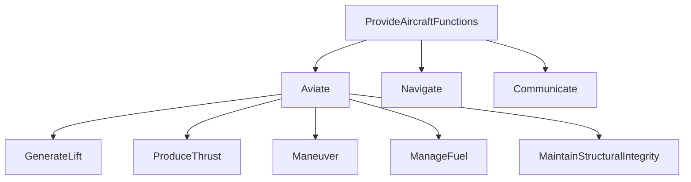

# F Layer — Functions

> `functions/F16A_Functional.slx` (capabilities) · `functions/F16A_MissionActivity.slx` (the mission)
> · `functions/F16A_Functional.sldd` (the typed flows of the mission)

The F layer tells **what the aircraft must do**, as verb phrases, independently of how it does it.

## Two kinds of function, two metaclasses

At first, you can think that the ten mission phases (Takeoff, Climb, …) are "the functions". But
phases are a **sequence in time**. Capabilities are things that the aircraft **can do at any time**,
and many phases use them. The example keeps them in different metaclasses, so that the model itself
shows the difference (D-059):

| | Artifact | Metaclass | Reason |
|---|---|---|---|
| The mission | `F16A_MissionActivity.slx` | activity diagram: **actions** on an object flow | a phase consumes an aircraft state and produces a lighter one |
| The capabilities | `F16A_Functional.slx` | architecture: **components**, no ports | a capability has no input or output of its own |

## The mission: an activity diagram



Ten actions send a typed `FlightState` object along the flow. The phase names are the same as the
tabs of the Brandt spreadsheet.

**Each action has its own behaviour.** The `BehaviorDefinition` of each phase is
`F16AMissionSegment('<phase>')`. Thus the model records **how** the fuel of each phase is computed,
not only a copy of the answer. `F16AMissionReference` runs `sizing/VnV/BrandtF16A/BrandtMission.m`
one time and caches the result. No file in `mbse/` restates a segment equation. The `Duration` of
each action comes from the same analysis.

```matlab
F16AMissionAnalysis   % prints each phase: 5,959.80 lb over 94.00 min, within 1% of the spreadsheet
```

The reference has fourteen segments, and the model has ten phases. The model omits three
zero-length `Patrol` waypoints and a degenerate `Climb2`. The analysis checks that all four still
use zero fuel and zero time, and stops if that changes. If it did not stop, the model would fly a
mission that uses less fuel and time than the mission that it claims.

### Combat → the F2T2EA kill chain

The behaviour of Combat is a **child activity**: the targeting cycle on a typed `EngagementData`
flow.



- Find detects targets.
- Fix gets their location and identifies them.
- Track keeps a track on them.
- Target assigns weapons.
- Engage releases the expendable payload.
- Assess evaluates the damage.

Combat is the only phase without a MATLAB binding, because an action has one behaviour, and the
behaviour of Combat is the kill chain. Its fuel still comes from the same analysis.

## The capabilities: a decomposition



There are nine components with no ports. They follow the aviator's rule *Aviate · Navigate ·
Communicate*. The flows belong to the mission. Sensing and engagement are inside the kill chain of
Combat. They are not repeated as capabilities.

## Requirement → function links

An **Implement** link connects each function to the requirement that it satisfies. Thus you can ask
from each end: is each requirement implemented, and does each function have a reason to exist?
There are **39 links**: 21 from capabilities and 18 from mission actions.

| Requirement | Implemented by |
|---|---|
| 001–010 (mission segments) | the ten phase actions, one each |
| 011–016 (point performance) | `GenerateLift` **and** `ProduceThrust` |
| 017 / 018 (field lengths) | `GenerateLift`, `ProduceThrust`, and the `Takeoff` / `Landing` action |
| 019 (9 g) | `MaintainStructuralIntegrity` |
| 021 (payload release) | `Engage` |
| D01–D04 | `Maneuver`, `ManageFuel`, `Navigate`, `Communicate` |
| D05–D09 | `Find`, `Fix`, `Track`, `Target`, `Assess` |

**D01–D09 are a small example of the RFLP loop.** The decomposition of the functions found
behaviour that the sizing-derived requirements do not mention. These functions were not left
without a requirement. Each need was recorded as a derived requirement and linked back. Functional
analysis feeds information *back* into R.

**Six requirements are not linked here, on purpose.** 020, 022, 023, 024, 025 and 026 constrain the
*solution* (payload, materials, balance, stability, cost), not the behaviour. Thus they trace to L
or P.

## Interfaces

`F16A_Functional.sldd` holds the two typed flows. The activity is their only user.

| Interface | Elements (all `double`) | Flows through |
|---|---|---|
| `FlightState` | `Time_s`, `Altitude_ft`, `Mach`, `WeightFraction` | the ten phases |
| `EngagementData` | `TargetDetected`, `TargetIdentified`, `WeaponReleased` | the kill chain |

Next: [Logical](04_logical.md). Each capability and kill-chain step is allocated to the role that
realizes it.
