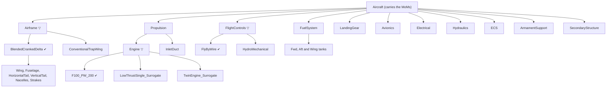

# P Layer — Physical

> `physical/F16A_Physical.slx` · profile `F16A_PhysicalProps.xml` · allocation
> `F16A_LogicalToPhysical.mldatx` · trades `F16A{Engine,Airframe,FlightControls}TradeStudy.m` ·
> roll-ups `F16APhysical{Mass,Materials,Fuel}Rollup.m` · cost `F16APhysicalCostModel.m`

L described the solution in roles and kinds. P gives **concrete parts with numbers**, and that is
why P is where the kinds get decided. Four ideas live here: **trade studies**, **roll-up analysis**,
**Measures of Merit**, and **verified by** links.

## The decomposition

Thirty components. `Aircraft` is the system of interest and carries the Measures of Merit. Three
assemblies are **variant roles** (`▽`): a role with more than one credible candidate is an open
question, and it is modelled as one. `✔` marks the candidate the trade selected.

Only the selected airframe is decomposed; the losing candidates are single lumped blocks. Detailing
`ConventionalTrapWing` would mean inventing six masses for an aircraft never built (D-003).
`InletDuct` sits beside the `Engine` variant because every candidate needs one (D-009). The fuel
tanks weigh **zero**: tankage is integral to the structure, and fuel is a consumable. They carry a
capacity instead.

## L → P allocation

The L→P set has **14 edges**, and it is where you can see which candidate realizes which kind:

| Kind (L) | → Candidates (P) |
|---|---|
| `SingleEngine` | `F100_PW_200`, `LowThrustSingle_Surrogate` |
| `TwinEngine` | `TwinEngine_Surrogate` |
| `BlendedCrankedDelta` · `ConventionalTrapWing` | the candidate of the same name |
| `FlyByWire` · `HydroMechanical` | the candidate of the same name |

The other seven edges go role → part: `PropulsionSystem` → `InletDuct`, `FuelSystem`, `LandingGear`,
`AvionicsSuite` and `CommunicationSystem` → `Avionics`, `WeaponSystem` and `MissionSystemsBay` →
`ArmamentSupport`.

**The edge is how the trade finds its way back to L.** `F16AKindOf` returns the source of a
candidate's edge, and the trade activates that kind. Engines are **many-to-one**: two candidates
realize `SingleEngine`.

**Allocation and variation are different relations.** An edge says only "this part realizes that
element". The variant structure is what says only one engine is installed. `Electrical`,
`Hydraulics`, `ECS` and `SecondaryStructure` receive no edge: they exist to serve other parts, which
mirrors L's constraint-driven roles.

## Trade studies

One script per decision. Each reads top to bottom: the four names that define the trade, the
**criteria table**, then four printed steps: *open* P, *read* every candidate, *score*, *pick*.
`F16ARecordTradeDecision` then records the result, the same way for all three.

Every criterion has a **value function declared in advance**, so adding a candidate never rescores
the others (D-015):

| Trade | Criterion | Value function | Weight |
|---|---|---|---:|
| Engine → `L01` | `Thrust_SL_lb` · `Mass_lb` · `TRL` | `T/T_ref` · `M_ref/M` · `(TRL−1)/8` | 0.30 · 0.35 · 0.35 |
| Airframe → `L03` | `AeroBenefit` · `Mass_lb` · `TRL` | `B/10` · `M_ref/M` · `(TRL−1)/8` | 0.50 · 0.25 · 0.25 |
| Flight controls → `L02` | `HandlingBenefit` · `Mass_lb` · `TRL` | `B/10` · `M_ref/M` · `(TRL−1)/8` | 0.50 · 0.25 · 0.25 |

`ref` is the role's one candidate tagged `DataProvenance = Reference` (the Brandt figure), so that
candidate scores exactly 1.0 on mass by construction.

| Trade | Candidate | Kind | Score |
|---|---|---|---:|
| Engine | **F100_PW_200** ✔ | SingleEngine | **0.95625** |
| | TwinEngine_Surrogate | TwinEngine | 0.88130 |
| | LowThrustSingle_Surrogate | SingleEngine | 0.68936 |
| Airframe | **BlendedCrankedDelta** ✔ | BlendedCrankedDelta | **0.91250** |
| | ConventionalTrapWing | ConventionalTrapWing | 0.77399 |
| Flight controls | **FlyByWire** ✔ | FlyByWire | **0.85625** |
| | HydroMechanical | HydroMechanical | 0.71873 |

**The engine trade is the one to study.** `TwinEngine_Surrogate` out-thrusts the F100 by 35% and
still loses, by +0.07495: thrust −0.10387, mass +0.09132, TRL +0.08750. Maturity and installed mass
outweigh a big thrust advantage. The thrust ratio also exceeds 1.0, so every run warns that the
weights no longer describe influence (D-035). Only the F100 is real; the two surrogates are declared
hypotheticals with invented numbers (D-053).

**The trade stops rather than score bad data.** It stops on: a value outside its criterion's
allowed range, a choice with no candidate stereotype, fewer than two candidates, anything other
than one `Reference` baseline, weights that do not sum to 1, or a tie.

### Where the decision is written

| Layer | What the trade writes |
|---|---|
| **P** | the active candidate; `Selected`; every candidate's `Rationale` (`TradeWinner` / `TradeAlternative`, with its score, margin and the criterion that decided it) |
| **L** | the active kind, `SolutionOption.Selected`, and `DecisionRef` on every kind |
| **R** | an Implement link from the winning kind to `REQ_F16A_L01`/`L02`/`L03`, rebuilt on each run (D-028) |

Losers are never deleted. A losing candidate's `Rationale` is the only place its reasoning exists
(D-002).

## Roll-ups and Measures of Merit

**Mass → OEW.** `F16APhysicalMassRollup` builds an analysis instance (`instantiate`) and sums the
tree, printing every subtotal. The instance holds only the **active** candidates, so the four losers'
masses stay out of the total: Airframe 6,722.88 + Propulsion 5,458.83 + … = **OEW 19,980.73 lb**.
The leaf masses are the Brandt F-16A component weights (`BrandtWeight`, W_TO = 31,377 lb).

| Measure of Merit (on `Aircraft`, minimize) | Value | Computed by |
|---|---|---|
| `OEW_lb` | 19,980.73 lb | mass roll-up (a sum) |
| `MissionFuel_lb` / `MissionTime_min` | 5,959.80 lb / 94.00 min | `F16AMissionAnalysis` ([02](02_functions.md)) |
| `UnitCost_USD` | $68.47M | DAPCA IV: `F16APhysicalCostModel` calls `BrandtCost` with this model's OEW |
| `OMCostAnnual_USD` / `OMCostLife_USD` / `LifeCycleCost_USD` | $1.24M / $24.77M / $93.24M | the same cost model, using the mission |

Cost is **not** a roll-up. Flyaway cost is not the sum of part prices; it comes from a parametric
model. Different Measures of Merit come from different analyses, and the model names where each
lives. No candidate carries a cost, because DAPCA IV prices an aircraft, not a part (D-043).

## Every part answers "why do I exist?"

`Rationale { SourceKind, Justification, TraceRef }` is on every part that can carry a stereotype, so
the answer is a **queryable property**, not a comment. `SourceKind` is a real enumeration
(`F16ASourceKind`): `RealizesFunction`, `SatisfiesRequirement`, `TradeWinner`, `TradeAlternative`,
`ConstraintDriven`, `SupportingInfrastructure`.

**Every number says where it came from** (`F16ADataProvenance`): `Reference` (Brandt ground truth),
`Datasheet`, `Simulation` (computed here) or `Estimate` (an invented teaching value, listed in
**D-030**). The tag qualifies the **mass**, not the judgement. Benefit and `TRL` are opinion on a
declared scale even on a `Reference` candidate (D-025).

## Constraints verified by roll-up

**Materials — `REQ_F16A_022`, ≤ 20% composite.** `F16APhysicalMaterialsRollup` computes the
**mass-weighted** fraction of the active airframe: 1,295.84 / 6,722.88 = **0.1928**. The plain
average would be 0.3417; Fuselage and Wing carry 81% of the mass at only 10–15% composite. The test
passes. **Every fraction is an `Estimate` chosen to land under the cap**, so the result shows the
check works and says nothing about the real F-16A.

**Fuel — `REQ_F16A_P01`.** `F16APhysicalFuelRollup` sums three 2,100 lb tanks to 6,300 lb available
(an `Estimate`; Brandt's figure is 6,296.30 lb). `F16APhysicalMissionFuel` reads the 5,959.80 lb
mission off the model. The test passes with about 340 lb of margin.

| Requirement | Kind | Implemented by | Verified by |
|---|---|---|---|
| `REQ_F16A_022` | constraint | `Airframe` variant (binds whichever candidate wins) | `F16AMaterialsVerificationTest` |
| `REQ_F16A_P01` | constraint | `FuelSystem` | `F16AFuelVerificationTest` |
| `REQ_F16A_026` / `P02` | Measure of Merit | `Aircraft` | — nothing to test against, only a number |

Why the trade lives here rather than at L: [06](06_methodology.md).
