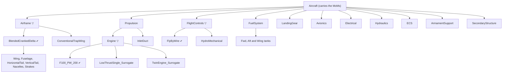

# P Layer — Physical

> `physical/F16A_Physical.slx` · profile `F16A_PhysicalProps.xml` · allocation
> `F16A_LogicalToPhysical.mldatx` · trades `F16A{Engine,Airframe,FlightControls}TradeStudy.m` ·
> roll-ups `F16APhysical{Mass,Materials,Fuel}Rollup.m` · cost `F16APhysicalCostModel.m`

L described the solution in roles and kinds. P gives **concrete parts with numbers**. For this
reason, P is the layer where the kinds are decided. P has four ideas: **trade studies**, **roll-up
analysis**, **Measures of Merit**, and **verified by** links.

## The decomposition

There are thirty components. `Aircraft` is the system of interest, and it carries the Measures of
Merit. Three assemblies are **variant roles** (`▽`). A role with more than one credible candidate is
an open question, and the model shows it as one. `✔` marks the candidate that the trade selected.

Only the selected airframe is decomposed. The losing candidates are single lumped blocks. To give
details of `ConventionalTrapWing`, you would have to invent six masses for an aircraft that was
never built (D-003). `InletDuct` is next to the `Engine` variant, because each candidate needs one
(D-009). The fuel tanks have a mass of **zero**. The tankage is part of the structure, and fuel is a
consumable. The tanks carry a capacity.

## L → P allocation

The L→P set has **14 edges**. It shows which candidate realizes which kind:

| Kind (L) | → Candidates (P) |
|---|---|
| `SingleEngine` | `F100_PW_200`, `LowThrustSingle_Surrogate` |
| `TwinEngine` | `TwinEngine_Surrogate` |
| `BlendedCrankedDelta` · `ConventionalTrapWing` | the candidate with the same name |
| `FlyByWire` · `HydroMechanical` | the candidate with the same name |

The other seven edges go from role to part: `PropulsionSystem` → `InletDuct`, `FuelSystem`,
`LandingGear`, `AvionicsSuite` and `CommunicationSystem` → `Avionics`, `WeaponSystem` and
`MissionSystemsBay` → `ArmamentSupport`.

**The trade uses the edge to find its way back to L.** `F16AKindOf` returns the source of the edge
of a candidate, and the trade makes that kind active. Engines are **many-to-one**: two candidates
realize `SingleEngine`.

**Allocation and variation are different relationships.** An edge tells only "this part realizes
that element". The variant structure tells that only one engine is installed. `Electrical`,
`Hydraulics`, `ECS` and `SecondaryStructure` get no edge. They exist to serve other parts, as the
constraint-driven roles of L do.

## Trade studies

There is one script for each decision. Each script reads from top to bottom:

1. the four names that define the trade
2. the **criteria table**
3. four printed steps: *open* P, *read* each candidate, *score*, *select*

Then `F16ARecordTradeDecision` records the result in the same way for all three trades.

Each criterion has a **value function declared before the trade**. Thus a new candidate never
changes the scores of the other candidates (D-015):

| Trade | Criterion | Value function | Weight |
|---|---|---|---:|
| Engine → `L01` | `Thrust_SL_lb` · `Mass_lb` · `TRL` | `T/T_ref` · `M_ref/M` · `(TRL−1)/8` | 0.30 · 0.35 · 0.35 |
| Airframe → `L03` | `AeroBenefit` · `Mass_lb` · `TRL` | `B/10` · `M_ref/M` · `(TRL−1)/8` | 0.50 · 0.25 · 0.25 |
| Flight controls → `L02` | `HandlingBenefit` · `Mass_lb` · `TRL` | `B/10` · `M_ref/M` · `(TRL−1)/8` | 0.50 · 0.25 · 0.25 |

`ref` is the one candidate of the role with the tag `DataProvenance = Reference` (the Brandt figure).
Thus, by definition, that candidate has a score of exactly 1.0 on mass.

| Trade | Candidate | Kind | Score |
|---|---|---|---:|
| Engine | **F100_PW_200** ✔ | SingleEngine | **0.95625** |
| | TwinEngine_Surrogate | TwinEngine | 0.88130 |
| | LowThrustSingle_Surrogate | SingleEngine | 0.68936 |
| Airframe | **BlendedCrankedDelta** ✔ | BlendedCrankedDelta | **0.91250** |
| | ConventionalTrapWing | ConventionalTrapWing | 0.77399 |
| Flight controls | **FlyByWire** ✔ | FlyByWire | **0.85625** |
| | HydroMechanical | HydroMechanical | 0.71873 |

**Study the engine trade.** `TwinEngine_Surrogate` has 35% more thrust than the F100, but it loses
by +0.07495: thrust −0.10387, mass +0.09132, TRL +0.08750. Maturity and installed mass are more
important than a large thrust advantage. The thrust ratio is also more than 1.0, so each run gives
a warning that the weights no longer describe influence (D-035). Only the F100 is real. The two
surrogates are declared hypothetical candidates with invented numbers (D-053).

**The trade stops, and does not score bad data.** It stops on these conditions:
- a value outside the allowed range of its criterion
- a choice with no candidate stereotype
- fewer than two candidates
- a number of `Reference` baselines that is not exactly one
- weights with a sum that is not 1
- a tie

### Where the decision is written

| Layer | What the trade writes |
|---|---|
| **P** | the active candidate. `Selected`. The `Rationale` of each candidate (`TradeWinner` / `TradeAlternative`, with its score, margin and the criterion that decided it) |
| **L** | the active kind, `SolutionOption.Selected`, and `DecisionRef` on each kind |
| **R** | an Implement link from the winning kind to `REQ_F16A_L01`/`L02`/`L03`, made again on each run (D-028) |

The trade never deletes losers. The `Rationale` of a losing candidate is the only location of its
reasoning (D-002).

## Roll-ups and Measures of Merit

**Mass → OEW.** `F16APhysicalMassRollup` builds an analysis instance (`instantiate`) and adds the
masses of the tree. It prints each subtotal. The instance holds only the **active** candidates.
Thus the masses of the four losers are not in the total: Airframe 6,722.88 + Propulsion 5,458.83 +
… = **OEW 19,980.73 lb**. The leaf masses are the Brandt F-16A component weights (`BrandtWeight`,
W_TO = 31,377 lb).

| Measure of Merit (on `Aircraft`, minimize) | Value | Computed by |
|---|---|---|
| `OEW_lb` | 19,980.73 lb | mass roll-up (a sum) |
| `MissionFuel_lb` / `MissionTime_min` | 5,959.80 lb / 94.00 min | `F16AMissionAnalysis` ([02](02_functions.md)) |
| `UnitCost_USD` | $68.47M | DAPCA IV: `F16APhysicalCostModel` calls `BrandtCost` with the OEW of this model |
| `OMCostAnnual_USD` / `OMCostLife_USD` / `LifeCycleCost_USD` | $1.24M / $24.77M / $93.24M | the same cost model, with the mission |

Cost is **not** a roll-up. Flyaway cost is not the sum of part prices. It comes from a parametric
model. Different Measures of Merit come from different analyses, and the model names the location
of each one. No candidate carries a cost, because DAPCA IV calculates the price of an aircraft, not
of a part (D-043).

## Each part answers "why do I exist?"

`Rationale { SourceKind, Justification, TraceRef }` is on each part that can carry a stereotype.
Thus the answer is a **property that you can query**, not a comment. `SourceKind` is a real
enumeration (`F16ASourceKind`): `RealizesFunction`, `SatisfiesRequirement`, `TradeWinner`,
`TradeAlternative`, `ConstraintDriven`, `SupportingInfrastructure`.

**Each number gives its source** (`F16ADataProvenance`): `Reference` (Brandt ground truth),
`Datasheet`, `Simulation` (computed here) or `Estimate` (an invented teaching value, listed in
**D-030**). The tag qualifies the **mass**, not the judgement. Benefit and `TRL` are opinions on a
declared scale, also on a `Reference` candidate (D-025).

## Constraints verified by roll-up

**Materials — `REQ_F16A_022`, ≤ 20% composite.** `F16APhysicalMaterialsRollup` computes the
**mass-weighted** fraction of the active airframe: 1,295.84 / 6,722.88 = **0.1928**. The plain
average would be 0.3417. Fuselage and Wing have 81% of the mass, with only 10–15% composite. The
test passes. **Each fraction is an `Estimate`, chosen to give a result below the cap.** Thus the
result shows that the check works. It tells nothing about the real F-16A.

**Fuel — `REQ_F16A_P01`.** `F16APhysicalFuelRollup` adds three 2,100 lb tanks to get 6,300 lb
available. This value is an `Estimate`. The Brandt figure is 6,296.30 lb. `F16APhysicalMissionFuel`
reads the 5,959.80 lb mission from the model. The test passes with approximately 340 lb of margin.

| Requirement | Kind | Implemented by | Verified by |
|---|---|---|---|
| `REQ_F16A_022` | constraint | `Airframe` variant (applies to the candidate that wins) | `F16AMaterialsVerificationTest` |
| `REQ_F16A_P01` | constraint | `FuelSystem` | `F16AFuelVerificationTest` |
| `REQ_F16A_026` / `P02` | Measure of Merit | `Aircraft` | — nothing to test against, only a number |

The reason that the trade is at P and not at L: [06](06_methodology.md).
