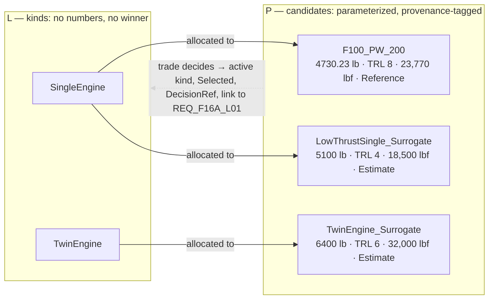

# Methodology — why the trade lives at P

> A method note. Read [`04_logical.md`](04_logical.md) and [`05_physical.md`](05_physical.md) first.

An earlier version of this example treated L and P as *estimate → actual*: L held options carrying
invented mass, cost and TRL figures, a script at L picked a winner, and P built it. That is
backwards. A logical role has no mass, because only a part does. The example now splits **options**
from **decisions**: L names the *kinds*, P parameterizes the *candidates* and decides.

## The boundary rule

> **A Logical option is an architectural *kind*: a configuration commitment free of technology,
> vendor and numbers. A Physical candidate is a concrete, parameterized *realization* of a kind: a
> technology commitment, with data and a provenance tag.**

| | Logical option (**kind**) | Physical candidate |
|---|---|---|
| Answers | *What shape of solution?* | *Built out of what, exactly?* |
| Examples | `SingleEngine` / `TwinEngine` | `F100_PW_200`, `LowThrustSingle_Surrogate`, `TwinEngine_Surrogate` |
| Carries | `SolutionOption { Selected, DecisionRef }` | `Mass_lb`, `TRL`, its trade's own criterion, `DataProvenance`, `Selected`, a `Rationale` |
| Owns the decision? | **No**: its active kind is written back from P | **Yes**: the trade runs here |
| Survives a technology generation? | Yes | No |

The rule is visible in the model as **allocation edges** from each kind to the candidates that
realize it:

The mapping is **many-to-one**: two engines realize `SingleEngine`. That is why the trade follows
the winner's edge to find the kind, and never uses the candidate's name.

### The three-question test

Ask of any box you are about to draw:

1. **Can you name a supplier, a part number or a specific technology for it?** → **P**.
2. **Does it carry a number somebody could measure, quote or dispute?** → **P**.
3. **Swap the technology underneath. Does the box's *name* still make sense?** If yes → **L**.
   `SingleEngine` outlives the F100; `F100_PW_200` does not.

Question 3 is the one that decides. `SingleEngine` vs `TwinEngine` is already a real architectural
commitment; it is free of *technology*, not of *solution*. Strict solution independence is the F
layer's job, where the function is just `ProduceThrust`.

## Where the rule comes from

1. **L is technology-neutral; P is where technology enters.** This is the defining split in
   **ARCADIA**: the logical architecture is *"technology neutral"*, and the physical architecture
   *"makes the logical architecture vision evolve according to implementation, technical and
   technological constraints and choices"* ([Capella/ARCADIA][arcadia]; [Voirin 2017][voirin]).
   SEBoK draws the same line ([SEBoK][sebok-la]).
2. **Synthesizing candidates and then trading them is a named MBSE activity.** INCOSE's **OOSEM**
   lists *"Synthesize Candidate Allocated Architectures"* then *"Optimize and Evaluate
   Alternatives"*, both after *"Define Logical Architecture"* ([OOSEM][oosem-wiki];
   [Lykins et al. 2000][lykins]). Scoring at L would invert that order.
3. **Variation points are the morphological box.** Laying out each design dimension with its values
   is **Zwicky's morphological box** ([Zwicky 1969][zwicky]), the engineering-design
   **morphological matrix** ([Pahl & Beitz][pahl]), and the product-line **feature model**
   ([Kang et al. 1990][foda]). A System Composer **variant component** is the tool's variation point
   ([MathWorks][sc-variant]). The three variant roles form a 3-dimensional box: L draws it, P fills
   the cells.
4. **Trading where the parameters live is the extended-RFLP pattern.** Swaminathan, Sarojini & Hwang
   join MBSE and MDO at the layer that carries parameters ([AIAA 2023][rflp-mdo]).
5. **Keeping every option until the evidence arrives is set-based design**
   ([Sobek et al. 1999][sobek]; [Singer et al. 2009][singer]; [Toche et al. 2020][toche];
   [Riaz et al. 2017][riaz]). The losing kinds and candidates are never deleted.

## What this example is *not*

Read this before repeating any of the above in a report.

- **It is a scripted trade study, not MDAO.** It is a weighted sum over a few pre-enumerated
  candidates: no optimizer, no continuous design variables, no coupled analysis. The word "MDAO"
  is kept out of the code on purpose (D-018).
- **Each variation point is decided on its own.** Three binary kinds make 8 combinations, but the
  example runs 3 separate pairs. That assumes the choices do not interact, which is **false** for
  the F-16: relaxed static stability only pays off *with* fly-by-wire (D-016).
- **It is set-based in structure only.** True set-based design narrows feasible regions across
  disciplines. Here the options are kept and the decision deferred, then made by one weighted score.
- **The answer was known in advance.** The production configuration wins all three trades, and the
  invented numbers were chosen to make that legible. It is a **retrodictive** exercise that
  demonstrates the method, the arithmetic and the audit trail. It is not evidence about aeroplanes.

### What the scoring assumes

Each criterion has a value function **declared in advance**: `B/10`, `(TRL−1)/8`, `M_ref/M`,
`T/T_ref`. This replaced min–max normalization across the candidates, which is degenerate at two
candidates and lets adding a candidate reorder the others (D-015). The fix does not make the scoring
objective:

- **Additivity is an assumption.** `Σ wᵢ·vᵢ(xᵢ)` is valid only under preference-independence
  conditions nobody checked ([Keeney & Raiffa 1993][keeney]).
- **A weight is a scaling constant, not importance.** It means something only relative to the
  criterion's range ([Parnell & Trainor 2009][parnell]; [Keeney 2002][keeney2002]). These weights
  were chosen by the author, not swing-weighted, with no sensitivity study behind them.
- **Linear value functions are a third assumption.** `(TRL−1)/8` says TRL 3→4 is worth exactly
  as much as TRL 8→9, which is almost certainly wrong.
- **The ratio criteria are unbounded.** `TwinEngine_Surrogate` scores `v = 1.346` on thrust, so a
  0.30 weight acts like 0.40. Every run warns about it (D-035).
- **Benefit and TRL are judgement, not measurement**, even on `Reference` candidates (D-025). Of
  each score, 0.75 is opinion in the airframe and flight-control trades, and 0.35 in the engine
  trade. Recording a judgement makes it transparent, not true.

## Further reading

| Source | What it grounds | Link |
|---|---|---|
| Capella/ARCADIA, *Arcadia method* | L is technology-neutral; P owns technology choices | [mbse-capella.org][arcadia] |
| Voirin, *Model-based System and Architecture Engineering with the Arcadia Method*, ISTE/Elsevier 2017 | Long-form ARCADIA reference | ISBN 978-1-78548-169-7 [link][voirin] |
| SEBoK, *Logical Architecture* | Logical architecture avoids technology constraints | [sebokwiki.org][sebok-la] |
| INCOSE OOSEM (activity list) | Synthesize candidates, then evaluate alternatives | [omgwiki.org][oosem-wiki] |
| Lykins, Friedenthal & Meilich, INCOSE IS 2000 | Original OOSEM method paper | [10.1002/j.2334-5837.2000.tb00416.x][lykins] |
| Zwicky, *Discovery, Invention, Research through the Morphological Approach*, 1969 | The morphological box | [archive.org][zwicky] |
| Pahl & Beitz et al., *Engineering Design*, 3rd ed., Springer 2007 | Morphological matrix; combinations interact | [10.1007/978-1-84628-319-2][pahl] |
| Kang et al., *FODA Feasibility Study*, CMU/SEI-90-TR-021, 1990 | Feature/variability modelling | [SEI report][foda] |
| MathWorks, *Variant Components in Architecture Models* | Tool-level variation point | [mathworks.com][sc-variant] |
| Swaminathan, Sarojini & Hwang, AIAA AVIATION 2023 | Extended RFLP as the MBSE↔MDO seam | [10.2514/6.2023-3908][rflp-mdo] |
| Sobek, Ward & Liker, *Sloan Mgmt. Review* 40(2), 1999 | Set-based concurrent engineering at Toyota | [sloanreview.mit.edu][sobek] |
| Singer, Doerry & Buckley, *Naval Engineers J.* 121(4), 2009 | "What Is Set-Based Design?" | [10.1111/j.1559-3584.2009.00226.x][singer] |
| Toche, Pellerin & Fortin, *Design Science* 6, 2020 | Set-based design review | [10.1017/dsj.2020.16][toche] |
| Riaz, Guenov & Molina-Cristobal, *J. Aircraft* 54(1), 2017 | Set-based design applied to aircraft | [10.2514/1.C033747][riaz] |
| Keeney & Raiffa, *Decisions with Multiple Objectives*, Cambridge UP 1993 | Additive value model and its independence conditions | [10.1017/CBO9781139174084][keeney] |
| Parnell & Trainor, INCOSE IS 19(1), 2009 | Weights depend on the attribute range | [10.1002/j.2334-5837.2009.tb00949.x][parnell] |
| Keeney, *Operations Research* 50(6), 2002 | Common mistakes in value tradeoffs | [10.1287/opre.50.6.935.357][keeney2002] |

[arcadia]: https://mbse-capella.org/arcadia.html
[voirin]: https://shop.elsevier.com/books/model-based-system-and-architecture-engineering-with-the-arcadia-method/voirin/978-1-78548-169-7
[sebok-la]: https://sebokwiki.org/wiki/Logical_Architecture
[oosem-wiki]: https://www.omgwiki.org/MBSE/doku.php?id=mbse:incoseoosem
[lykins]: https://doi.org/10.1002/j.2334-5837.2000.tb00416.x
[zwicky]: https://archive.org/details/discoveryinventi0000zwic
[pahl]: https://doi.org/10.1007/978-1-84628-319-2
[foda]: https://www.sei.cmu.edu/library/feature-oriented-domain-analysis-foda-feasibility-study/
[sc-variant]: https://www.mathworks.com/help/systemcomposer/variant-components-in-architecture-models.html
[rflp-mdo]: https://doi.org/10.2514/6.2023-3908
[sobek]: https://sloanreview.mit.edu/article/toyotas-principles-of-setbased-concurrent-engineering/
[singer]: https://doi.org/10.1111/j.1559-3584.2009.00226.x
[toche]: https://doi.org/10.1017/dsj.2020.16
[riaz]: https://doi.org/10.2514/1.C033747
[keeney]: https://doi.org/10.1017/CBO9781139174084
[parnell]: https://doi.org/10.1002/j.2334-5837.2009.tb00949.x
[keeney2002]: https://doi.org/10.1287/opre.50.6.935.357
