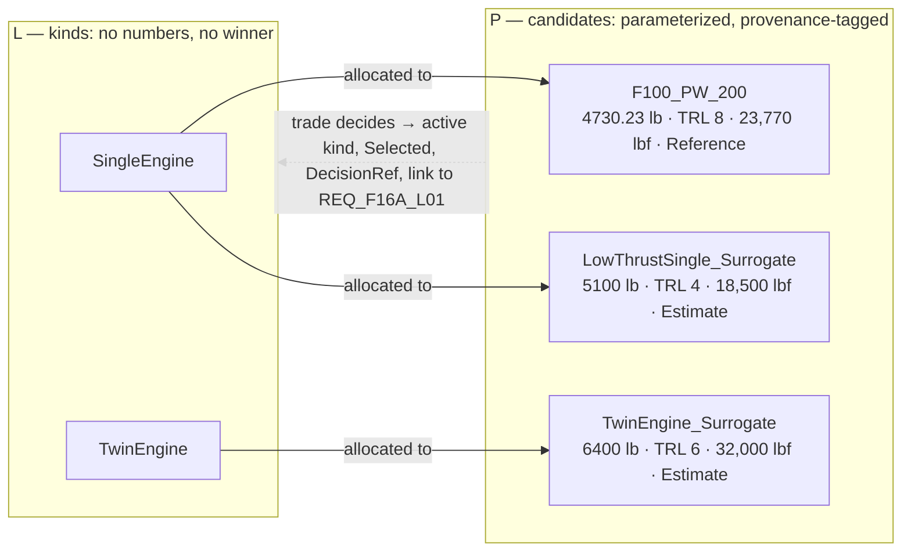

# Methodology — why the trade is at P

> A note about the method. Read [`04_logical.md`](04_logical.md) and [`05_physical.md`](05_physical.md)
> first.

An earlier version of this example used L and P as *estimate → actual*. L held options with
invented mass, cost and TRL figures, a script at L selected a winner, and P built it. That order is
incorrect. A logical role has no mass. Only a part has mass. The example now separates **options**
from **decisions**: L names the *kinds*, and P gives parameters to the *candidates* and makes the
decision.

## The boundary rule

> **A Logical option is an architectural *kind*: a configuration commitment with no technology, no
> vendor and no numbers. A Physical candidate is a concrete, parameterized *realization* of a kind: a
> technology commitment, with data and a provenance tag.**

| | Logical option (**kind**) | Physical candidate |
|---|---|---|
| Answers | *What shape of solution?* | *Built from what, exactly?* |
| Examples | `SingleEngine` / `TwinEngine` | `F100_PW_200`, `LowThrustSingle_Surrogate`, `TwinEngine_Surrogate` |
| Carries | `SolutionOption { Selected, DecisionRef }` | `Mass_lb`, `TRL`, the criterion of its own trade, `DataProvenance`, `Selected`, a `Rationale` |
| Owns the decision? | **No**: P writes its active kind back | **Yes**: the trade runs here |
| Stays correct after a technology generation? | Yes | No |

The model shows the rule as **allocation edges** from each kind to the candidates that realize it:

The mapping is **many-to-one**: two engines realize `SingleEngine`. For this reason, the trade
follows the edge of the winner to find the kind. It never uses the candidate name.

### The three-question test

Ask these questions about each box before you draw it:

1. **Can you name a supplier, a part number or a specific technology for it?** → **P**.
2. **Does it carry a number that somebody can measure, quote or dispute?** → **P**.
3. **Replace the technology under the box. Is the *name* of the box still correct?** If yes → **L**.
   `SingleEngine` stays correct after the F100. `F100_PW_200` does not.

Question 3 makes the decision. `SingleEngine` vs `TwinEngine` is already a real architectural
commitment. It has no *technology* in it, but it does have a *solution* in it. Strict solution
independence is the job of the F layer, where the function is only `ProduceThrust`.

## Where the rule comes from

1. **L is technology-neutral. P is where technology enters.** This is the defining separation in
   **ARCADIA**. The logical architecture is *"technology neutral"*, and the physical architecture
   *"makes the logical architecture vision evolve according to implementation, technical and
   technological constraints and choices"* ([Capella/ARCADIA][arcadia], [Voirin 2017][voirin]).
   SEBoK makes the same separation ([SEBoK][sebok-la]).
2. **To synthesize candidates and then trade them is a named MBSE activity.** The INCOSE **OOSEM**
   lists *"Synthesize Candidate Allocated Architectures"* and then *"Optimize and Evaluate
   Alternatives"*. Both come after *"Define Logical Architecture"* ([OOSEM][oosem-wiki],
   [Lykins et al. 2000][lykins]). Scoring at L would invert that order.
3. **Variation points are the morphological box.** A layout of each design dimension with its values
   is **Zwicky's morphological box** ([Zwicky 1969][zwicky]). It is also the engineering-design
   **morphological matrix** ([Pahl & Beitz][pahl]) and the product-line **feature model**
   ([Kang et al. 1990][foda]). A System Composer **variant component** is the variation point of the
   tool ([MathWorks][sc-variant]). The three variant roles make a 3-dimensional box: L draws it, and
   P fills the cells.
4. **A trade at the layer that has the parameters is the extended-RFLP pattern.** Swaminathan,
   Sarojini & Hwang join MBSE and MDO at the layer that carries parameters ([AIAA 2023][rflp-mdo]).
5. **To keep all options until the evidence arrives is set-based design**
   ([Sobek et al. 1999][sobek], [Singer et al. 2009][singer], [Toche et al. 2020][toche],
   [Riaz et al. 2017][riaz]). The losing kinds and candidates are never deleted.

## What this example is *not*

Read this section before you repeat any of the text above in a report.

- **It is a scripted trade study, not MDAO.** It is a weighted sum over a small number of
  candidates that are listed before the trade. It has no optimizer, no continuous design variables
  and no coupled analysis. The word "MDAO" is kept out of the code on purpose (D-018).
- **Each variation point is decided independently.** Three binary kinds make 8 combinations, but
  the example runs 3 separate pairs. This assumes that the choices do not interact. For the F-16,
  that assumption is **false**: relaxed static stability gives a benefit only *with* fly-by-wire
  (D-016).
- **It is set-based in structure only.** Real set-based design makes feasible regions smaller across
  disciplines. Here, the options are kept and the decision is delayed. Then one weighted score makes
  the decision.
- **The answer was known before the trade.** The production configuration wins all three trades,
  and the invented numbers were chosen to make that clear. It is a **retrodictive** exercise. It
  shows the method, the arithmetic and the audit trail. It is not evidence about aeroplanes.

### What the scoring assumes

Each criterion has a value function **declared before the trade**: `B/10`, `(TRL−1)/8`, `M_ref/M`,
`T/T_ref`. These functions replaced min–max normalization across the candidates. Min–max
normalization is degenerate with two candidates, and a new candidate can change the order of the
others (D-015). The new functions do not make the scoring objective:

- **Additivity is an assumption.** `Σ wᵢ·vᵢ(xᵢ)` is valid only under preference-independence
  conditions that nobody checked ([Keeney & Raiffa 1993][keeney]).
- **A weight is a scaling constant, not importance.** It has a meaning only relative to the range of
  the criterion ([Parnell & Trainor 2009][parnell], [Keeney 2002][keeney2002]). The author chose
  these weights. They are not swing-weighted, and no sensitivity study supports them.
- **Linear value functions are a third assumption.** `(TRL−1)/8` says that TRL 3→4 has exactly the
  same value as TRL 8→9. This is almost certainly incorrect.
- **The ratio criteria have no upper limit.** `TwinEngine_Surrogate` has `v = 1.346` on thrust, so a
  0.30 weight has the effect of 0.40. Each run gives a warning about it (D-035).
- **Benefit and TRL are judgement, not measurement**, also on `Reference` candidates (D-025). In the
  airframe and flight-control trades, 0.75 of each score is opinion. In the engine trade, 0.35 is
  opinion. A recorded judgement is transparent, but this does not make it true.

## Further reading

| Source | What it supports | Link |
|---|---|---|
| Capella/ARCADIA, *Arcadia method* | L is technology-neutral. P owns technology choices | [mbse-capella.org][arcadia] |
| Voirin, *Model-based System and Architecture Engineering with the Arcadia Method*, ISTE/Elsevier 2017 | Long-form ARCADIA reference | ISBN 978-1-78548-169-7 [link][voirin] |
| SEBoK, *Logical Architecture* | Logical architecture avoids technology constraints | [sebokwiki.org][sebok-la] |
| INCOSE OOSEM (activity list) | Synthesize candidates, then evaluate alternatives | [omgwiki.org][oosem-wiki] |
| Lykins, Friedenthal & Meilich, INCOSE IS 2000 | Original OOSEM method paper | [10.1002/j.2334-5837.2000.tb00416.x][lykins] |
| Zwicky, *Discovery, Invention, Research through the Morphological Approach*, 1969 | The morphological box | [archive.org][zwicky] |
| Pahl & Beitz et al., *Engineering Design*, 3rd ed., Springer 2007 | Morphological matrix. Combinations interact | [10.1007/978-1-84628-319-2][pahl] |
| Kang et al., *FODA Feasibility Study*, CMU/SEI-90-TR-021, 1990 | Feature and variability modelling | [SEI report][foda] |
| MathWorks, *Variant Components in Architecture Models* | Variation point in the tool | [mathworks.com][sc-variant] |
| Swaminathan, Sarojini & Hwang, AIAA AVIATION 2023 | Extended RFLP as the connection between MBSE and MDO | [10.2514/6.2023-3908][rflp-mdo] |
| Sobek, Ward & Liker, *Sloan Mgmt. Review* 40(2), 1999 | Set-based concurrent engineering at Toyota | [sloanreview.mit.edu][sobek] |
| Singer, Doerry & Buckley, *Naval Engineers J.* 121(4), 2009 | "What Is Set-Based Design?" | [10.1111/j.1559-3584.2009.00226.x][singer] |
| Toche, Pellerin & Fortin, *Design Science* 6, 2020 | Review of set-based design | [10.1017/dsj.2020.16][toche] |
| Riaz, Guenov & Molina-Cristobal, *J. Aircraft* 54(1), 2017 | Set-based design applied to aircraft | [10.2514/1.C033747][riaz] |
| Keeney & Raiffa, *Decisions with Multiple Objectives*, Cambridge UP 1993 | Additive value model and its independence conditions | [10.1017/CBO9781139174084][keeney] |
| Parnell & Trainor, INCOSE IS 19(1), 2009 | Weights depend on the attribute range | [10.1002/j.2334-5837.2009.tb00949.x][parnell] |
| Keeney, *Operations Research* 50(6), 2002 | Common mistakes in value tradeoffs | [10.1287/opre.50.6.935.357][keeney2002] |

[arcadia]: https://mbse-capella.org/arcadia.html
[voirin]: https://shop.elsevier.com/books/model-based-system-and-architecture-engineering-with-the-arcadia-method/voirin/978-1-78548-169-7
[sebok-la]: https://sebokwiki.org/wiki/Logical_Architecture
[oosem-wiki]: https://www.omgwiki.org/MBSE/doku.php?id=mbse:incoseoosem
[lykins]: https://doi.org/10.1002/j.2334-5837.2000.tb00416.x
[zwicky]: https://archive.org/details/discoveryinventi0000zwic
[pahl]: https://doi.org/10.1007/978-1-84628-319-2
[foda]: https://www.sei.cmu.edu/library/feature-oriented-domain-analysis-foda-feasibility-study/
[sc-variant]: https://www.mathworks.com/help/systemcomposer/variant-components-in-architecture-models.html
[rflp-mdo]: https://doi.org/10.2514/6.2023-3908
[sobek]: https://sloanreview.mit.edu/article/toyotas-principles-of-setbased-concurrent-engineering/
[singer]: https://doi.org/10.1111/j.1559-3584.2009.00226.x
[toche]: https://doi.org/10.1017/dsj.2020.16
[riaz]: https://doi.org/10.2514/1.C033747
[keeney]: https://doi.org/10.1017/CBO9781139174084
[parnell]: https://doi.org/10.1002/j.2334-5837.2009.tb00949.x
[keeney2002]: https://doi.org/10.1287/opre.50.6.935.357
