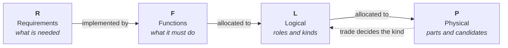

# F-16A RFLP MBSE Example

This is a teaching model of the **F-16A**. It uses the **RFLP** framework in System Composer and
Requirements Toolbox (MATLAB R2026b). It shows two things:

- **Traceability** from a requirement down to a part.
- **Trade studies** that select one of a set of competing designs and record the decision in the
  model.



Each layer is a separate artifact. Links and allocation sets connect the layers. Thus the model can
always answer *"why does this part exist?"* and *"where is this requirement satisfied?"*.

## Open it

```matlab
openProject("f16a.prj")
F16AOpenForReview      % loads all models, requirement sets and link sets; opens the Requirements Editor
```

## Walk through it

| Step | Look at | Open with | The idea |
|---|---|---|---|
| **1 · R** | 26 requirements from the Brandt F-16A sizing model, plus derived sets | `slreq.editor` | Only spreadsheet *inputs* become requirements ([01](01_requirements.md)) |
| **2 · F** | 9 capabilities and the 10-phase mission activity | `systemcomposer.openModel("F16A_Functional")`, `systemcomposer.openActivity("F16A_MissionActivity")` | Capabilities are structure. The mission is behaviour ([02](02_functions.md)) |
| **3 · L** | 9 solution roles. 3 of them hold two competing **kinds** | `systemcomposer.openModel("F16A_Logical")` | L gives options. It does not select one ([04](04_logical.md)) |
| **4 · Trade** | one script for each decision | `F16AEngineTradeStudy` (also Airframe, FlightControls) | Score the P candidates. Write the winner into P, L and R ([05](05_physical.md#trade-studies)) |
| **5 · P** | 30 parts, 7 candidates, and the kind of each candidate | `systemcomposer.openModel("F16A_Physical")`, `systemcomposer.allocation.editor` | Roll-ups compute emergent totals ([05](05_physical.md)) |
| **6 · Verify** | three requirements with tests | `runtests("verification")` | Met and not met are both results ([below](#three-requirements-two-verification-states)) |

Each trade and roll-up prints its steps and each number that it reads. Thus you can check the
arithmetic by hand. `F16AEngineTradeStudy(Record=false)` calculates the scores and writes nothing.

## Traceability at a glance

| Relationship | From → to | Stored in | Count |
|---|---|---|:-:|
| Implement | capability / mission action → requirement | `functions/*~mdl.slmx` | 21 + 18 |
| Allocation | capability → role · kill-chain action → role | `logical/F16A_FunctionToLogical.mldatx` · `F16A_KillChainToLogical.mldatx` | 7 + 7 |
| Implement | role or kind → requirement | `logical/F16A_Logical~mdl.slmx` | 7 |
| Allocation | role → part · **kind → candidate** | `physical/F16A_LogicalToPhysical.mldatx` | 14 |
| Implement | part → requirement | `physical/F16A_Physical~mdl.slmx` | 4 |
| Verify | test → requirement | `verification/*~m.slmx` | 3 requirements |

**A link is stored with the artifact that it starts from, not with the requirement.** If you open
`f16a.slreqx` alone, all requirements look unimplemented, because the links are stored with the
models and the tests. `F16AOpenForReview` loads the models and the tests.

**The kind → candidate edges connect the trade to L.** `SingleEngine` is allocated to both
`F100_PW_200` and `LowThrustSingle_Surrogate`. `TwinEngine` is allocated to `TwinEngine_Surrogate`.
When a candidate wins, the trade follows its edge back to the kind and makes that kind active at L.

Six requirements have no function to trace to, because they constrain the solution, not the
behaviour. 020, 023, 024 and 025 trace to L roles. 022 and 026 trace to P parts.

## Three requirements, two verification states

```matlab
runtests("F16AMaterialsVerificationTest")      % REQ_F16A_022 — green
runtests("F16AFuelVerificationTest")           % REQ_F16A_P01 — green
runtests("F16AStaticMarginVerificationTest")   % REQ_F16A_025 — 2 pass, 1 RED BY DESIGN
```

| Requirement | State | What it teaches |
|---|---|---|
| `REQ_F16A_022` composite ≤ 20% | 🟢 met | the evidence is a roll-up over the model |
| `REQ_F16A_P01` fuel volume | 🟢 met | 6,300 lb of tankage against 5,960 lb of mission fuel from the `/sizing/` analysis |
| `REQ_F16A_025` static margin | 🔴 **violated** | the requirement *was* evaluated, and the design does not meet it |

**One red is the expected state. A second red is a regression.** When
`testAnalysisProducedUsableMargins` passes, it proves that the analysis ran. Thus the landing red is
a verdict, not a broken tool. The red comes from the simplified reference model, not from the real
F-16A ([01](01_requirements.md#025--static-margin)).

A Verify link records that a requirement is checked, and what checks it. It does not record that
the check passed.

## Exercises

1. **Write the missing criteria.** `REQ_F16A_D01`–`D09` state a need with `TBD` acceptance criteria.
   No external source defines them, so the blanks are the assignment.
2. **Decide the gear angles.** `REQ_F16A_023`/`024` are blank because the angles in Brandt possibly
   do not use the same convention as the specifications. The brief is in
   [01](01_requirements.md#023--024--the-gear-angle-exercise).
3. **Add a fourth engine.** Do these steps:
   1. Add a choice under `F16A_Physical/Aircraft/Propulsion/Engine`.
   2. Apply `EngineCandidate`, and fill in its properties and `DataProvenance`.
   3. Allocate it from a kind in the L→P allocation set.
   4. Run `F16AEngineTradeStudy`.

   If you do not do the allocation, the trade stops and tells you which candidate has no kind.
4. **Move a weight.** Change a weight in the criteria table of a trade. How much can the weight
   change before the winner changes?
5. **Go further:**
   - Name the criterion that decides *independently of the rival* (D-034).
   - Put limits on the ratio value functions (D-035).
   - Search the 2×2×2 combinations, not three separate pairs (D-016).
   - Draw the F2T2EA kill chain as a sequence diagram. `addInteraction` is available in R2026b.

## Folder layout

```
f16a/
├─ f16a.prj · f16aRoot.m · F16AOpenForReview.m
├─ F16ARunAnalyses.m          changed a number? run all trades and analyses again
├─ requirements/              f16a (26) · functional_derived (D01–D09) · logical_derived (L01–L03)
│                             · physical_derived (P01, P02)
├─ functions/                 F16A_Functional.slx (+ .sldd for the flows of the activity)
│                             · F16A_MissionActivity.slx · F16AMission{Analysis,Segment,Reference}.m
├─ logical/                   F16A_Logical.slx · F16A_LogicalOptions.xml · two F→L allocation sets
├─ physical/                  F16A_Physical.slx · F16A_PhysicalProps.xml · F16A_LogicalToPhysical.mldatx
│                             · F16A{Engine,Airframe,FlightControls}TradeStudy.m (steps 1–4)
│                             · F16ARecordTradeDecision.m (steps 5–6, shared) · F16AKindOf.m
│                             · F16APhysical{Mass,Materials,Fuel}Rollup.m · F16APhysicalCostModel.m
│                             · F16APhysicalMissionFuel.m · F16ASourceKind.m · F16ADataProvenance.m
├─ verification/              one test for each verified requirement, with its Verify link set
├─ tests_for_ai_coding/       F16ABaselineTest: did a number change? · F16AVerifyLinksTest: is each
│                             Verify link still on its test method? (not teaching material)
├─ resources/                 MATLAB project metadata (file registry, labels, path). Change it through the project
└─ derived/                   cache that the project writes when tests or requirements run. Git ignores it
```

| Document | Contents |
|---|---|
| [`01_requirements.md`](01_requirements.md) | R: provenance, structure, the derived sets, the gear-angle and static-margin cases |
| [`02_functions.md`](02_functions.md) | F: capabilities, the mission activity, F2T2EA, R→F links |
| [`04_logical.md`](04_logical.md) | L: roles, F→L allocation, the kinds and how the decision comes back |
| [`05_physical.md`](05_physical.md) | P: parts, kind→candidate allocation, trade studies, roll-ups, MoMs |
| [`06_methodology.md`](06_methodology.md) | Why the trade is at P, its sources, and what weighted-sum scoring does not justify |
| [`07_decision_log.md`](07_decision_log.md) | Standing decisions (D-0xx). **D-030 lists every invented number** |

## Maintaining the model

The models, requirement sets and allocation sets are the source of truth. Edit them in the editors
or through the API. Then run:

```matlab
F16ARunAnalyses     % trades → roll-ups → mission → cost, written back into the models
run_ai_tests        % each number against its baseline, each Verify link on its method; must pass
```

- **Never build a model again from the start.** Allocation sets and Verify links point at element
  SIDs, and a new model has new SIDs.
- **Add, move or delete files through the project** (`addFile`/`removeFile`). Then
  `runChecks(currentProject)` must report 12/12. `removeFile` also stages the git deletion.
- **Keep `.m` files LF, also on Windows.** A Verify link stores a character offset into its test
  file. CRLF adds one character to each line, and this moves the link off its method. Then
  `runTests` on a requirement set reports incorrect failures. `.gitattributes` sets
  `*.m text eol=lf`. `F16AVerifyLinksTest` fails if a test file has CRLF or if a link has moved (for
  example, after an edit to a test). To re-point a link, use `setLineRange` on
  `slreq.getTextRanges(file)`. Then save the link set of the test.
- `F16ASourceKind.m` and `F16ADataProvenance.m` give the types of two stereotype properties. Thus
  they must be on the path when `F16A_PhysicalProps` loads. The project path does this.

API behaviour measured on this model (R2026b):

| Topic | Behaviour |
|---|---|
| String and enum stereotype properties | stored as expressions. Write `"'TBD'"`. The value reads back as `'TBD'`, with quotes. Remove them with `erase(…, "'")` |
| Variant choices | get them only with `getChoices`. They are not in `Architecture.Components` of the parent |
| Analysis instance | holds only the active choice, flattened under the variant node |
| Decision links | run `slreq.load("F16A_Logical")` before linking. If not, the links into L01–L03 are duplicated |
| Requirement link from an activity action | `slreq.createLink(action.SimulinkHandle, req)`. Allocation takes the action object |
| Activity nodes | `addNode(name, type)`, name first. `connect` is a method of the nodes. An action whose behaviour is an activity has no settable `Duration` |
| Verify link from a test | `slreq.createLink(slreq.createTextRange(testFile, lines), req)`, then set `Type = "Verify"`. The shipped links were made by hand before this method worked. The range is a character offset, so the test file must be LF |
| `NaN` into a property | `string(NaN)` is `<missing>`, and `setProperty` rejects it. Use `string(num2str(NaN))` |

Prerequisites: MATLAB R2026b · Simulink · System Composer · Requirements Toolbox. The cost model, the
mission and the static-margin test also call `sizing/VnV/BrandtF16A/`, three folders up.
